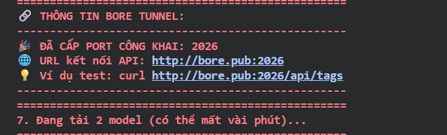
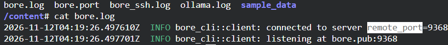
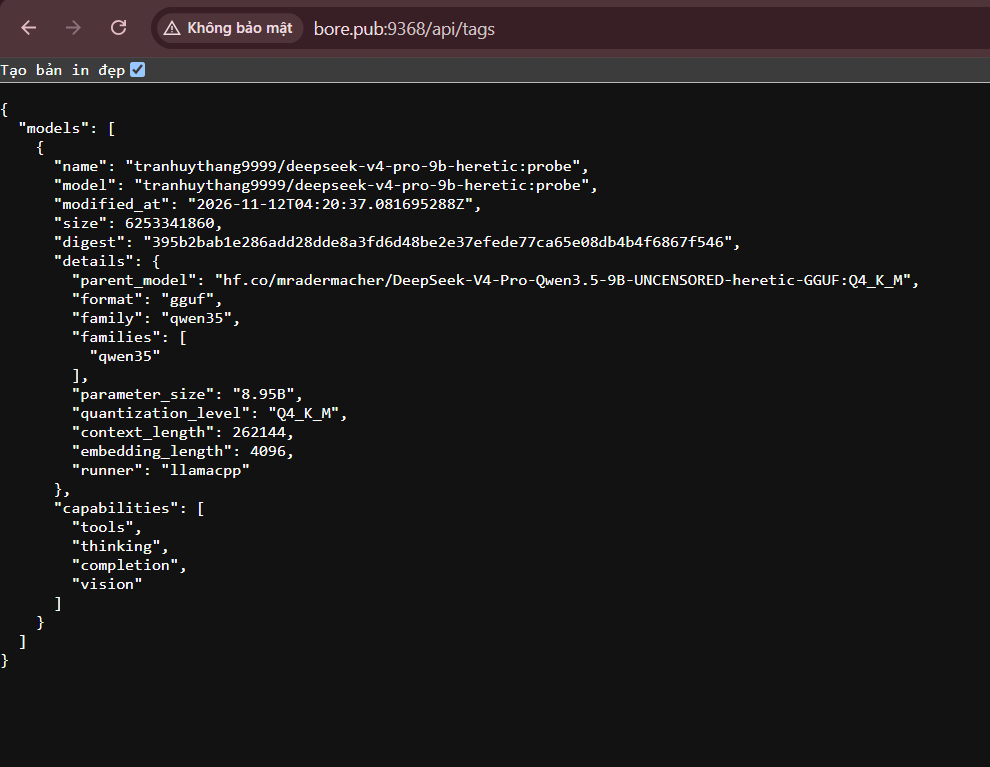

# TunnelFlow-UB

Run **Ollama** on Google Colab and expose it with a **Bore** tunnel: one cell, and you get a working
`http://bore.pub:<PORT>` endpoint.

## Run it

1. Open the notebook in Colab:

   ```
   https://colab.research.google.com/github/TheronThayer9999/TunnelFlow-UB/blob/master/TunnelFlow-UB.ipynb
   ```

2. Runtime → Change runtime type → **T4 GPU** → Save (one time; Colab cannot do it from code).
3. Connect, then press ▶ on the setup cell (or **Run all**). It installs Bore + Ollama, opens the tunnel, verifies the
   port with `curl`, pulls the model and calls it through the public URL.
4. Use the `API: http://bore.pub:<PORT>` line it prints.

No GPU? The cell warns and falls back to `qwen2.5:0.5b` on CPU.

## Files

| File | Purpose |
|---|---|
| `TunnelFlow-UB.ipynb` | Main notebook: setup, optional SSH cell, runnable Python client, screenshots |
| `script_tunnel.sh` | Same Ollama + tunnel setup as a single `%%bash` cell |
| `script_ssh.sh` | SSH server + a second Bore tunnel for `ssh -p <PORT> root@bore.pub` |

## The bug that is fixed here

Bore v0.6.0 logs a timestamp, so the old extraction read the **year** as the port:

```text
log : 2026-11-12T04:19:26.497610Z  INFO bore_cli::client: listening at bore.pub:9368
old : grep -o '[0-9]\{4,5\}' | head -n 1               -> 2026   (wrong)
new : grep -oE 'bore\.pub:[0-9]{1,5}' | sed 's/.*://'  -> 9368   (correct)
```







Other fixes: wait loop instead of `sleep 4`, ANSI/`\r` stripped, `set -e` safe, the port is verified with `curl` before
it is printed, and tunnel cleanup is per-port so the SSH tunnel never kills the Ollama tunnel.

## Notes

- A free Colab runtime stops after ~12 h or when idle → re-run the cell, the port changes.
- `bore.pub` assigns a random port; add `--port <n>` to `bore local` if you need a fixed one.
- The SSH cell publishes `root` with a plain password (`MySecurePass123` by default) — change it or set `ENABLE_SSH=0`.
